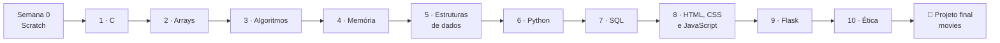
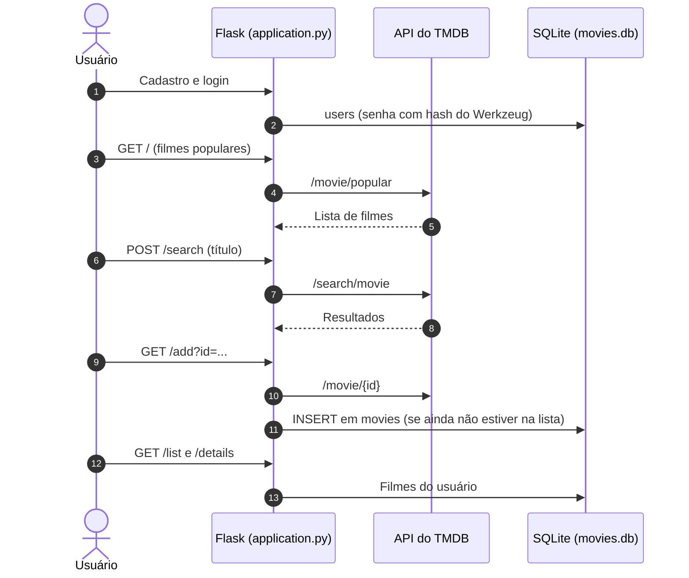

# 🎓 CS50's Introduction to Computer Science — Exercícios e Projeto Final


> Do C ao Flask: as soluções dos problem sets, laboratórios e exemplos de aula do CS50, mais o projeto final.

Este repositório reúne o que desenvolvi no **CC50: Introdução à Ciência da Computação**, a edição brasileira, legendada, do **CS50's Introduction to Computer Science** da **Universidade Harvard**. O curso parte da programação em **C** — memória, algoritmos e estruturas de dados — e passa por **Python**, **SQL**, **HTML, CSS e JavaScript** até aplicações web com **Flask**. Cada pasta `psetN` corresponde a uma semana do curso, com os exercícios do problem set, o laboratório e os exemplos das aulas. O **projeto final** é uma aplicação Flask para montar uma lista pessoal de filmes a partir da API do TMDB.



---

## ✨ Sobre o Curso

O CS50 é o curso introdutório de Ciência da Computação de Harvard. A edição em português, **CC50**, mantém as aulas originais com legendas e organiza o conteúdo em módulos semanais, cada um com atividades de fixação e, em alguns, laboratórios práticos.

| Módulo | Conteúdo | Carga horária | Pasta |
| :---: | :--- | :---: | :--- |
| Introdução | Apresentação dos professores e ferramentas do curso | 0,5 h | — |
| 0 | Conceitos básicos de programação com Scratch | 6,5 h | — |
| 1 | Linguagem C | 6,5 h | [`pset1`](pset1) |
| 2 | Arrays | 6,5 h | [`pset2`](pset2) |
| 3 | Algoritmos | 6,5 h | [`pset3`](pset3) |
| 4 | Memória | 6,5 h | [`pset4`](pset4) |
| 5 | Estruturas de Dados | 6,5 h | [`pset5`](pset5) |
| 6 | Python | 6,5 h | [`pset6`](pset6) |
| 7 | SQL | 6,5 h | [`pset7`](pset7) |
| 8 | HTML, CSS e JavaScript | 6,5 h | [`pset8`](pset8) |
| 9 | Flask | 6,5 h | [`pset9`](pset9) |
| 10 | Ética | 4 h | — |
| Encerramento | Agradecimentos e finalização | 0,5 h | — |
| | **Total** | **70 h** | |

---

## 🧩 Problem Sets & Laboratórios

| Semana | Exercícios (`exercises/`) | Laboratório (`lab/`) | Exemplos de aula (`examples/`) |
| :---: | :--- | :--- | :--- |
| **1 · C** | `cash`, `credit`, `mario` (com a versão `desafio`) | `population` | `hello`, `if`, `mario`, `math`, `meow`, `text` |
| **2 · Arrays** | `caesar`, `readability` | `scrabble` | `binary.c`, `scores.c` |
| **3 · Algoritmos** | `plurality`, `runoff` | `sort` (análise de três algoritmos de ordenação em `answers.txt`) | — |
| **4 · Memória** | `filter` (filtros de imagem BMP) | `volume` | `adress`, `copy`, `file`, `mario`, `memory`, `scanf`, `swap` |
| **5 · Estruturas de Dados** | `speller` (corretor ortográfico com tabela hash) | `inheritance` | `list`, `realloc`, `telephone` |
| **6 · Python** | `cash`, `credit`, `mario` (com `desafio`), `readability` — as soluções da semana 1 reescritas em Python | `World Cup` | `arg`, `book`, `hello`, `house`, `mario`, `math`, `meow`, `qr`, `scores`, `text` |
| **7 · SQL** | `fiftyville` (investigação com consultas em `log.sql`), `movies` | `songs` | — |
| **8 · HTML, CSS e JavaScript** | `homepage` | `trivia` | `hello`, `search` |
| **9 · Flask** | `finance` (simulador de compra e venda de ações), `form` | `birthdays` | `hello`, `login` |

---

## 🏁 Projeto Final — Movies

Aplicação web em **Flask** para montar uma lista pessoal de filmes. Os dados dos filmes vêm da API do **[The Movie Database (TMDB)](https://www.themoviedb.org/)**, e os usuários e as listas ficam em um banco **SQLite**.



| Rota | O que faz | Acesso |
| :--- | :--- | :--- |
| `/register` | Cadastro de usuário | Público |
| `/login` · `/logout` | Entrada e saída da sessão | Público |
| `/` | Filmes populares do TMDB | Logado |
| `/search` | Busca de filmes por título | Logado |
| `/add?id=` | Adiciona o filme à lista do usuário, sem duplicar | Logado |
| `/list` | Lista pessoal de filmes | Logado |
| `/details?code=` | Detalhes de um filme da lista | Logado |
| `/remove?id=` | Remove um filme da lista | Logado |

---

## 🛠️ Stack Tecnológica

| Semanas | Tecnologias |
|---|---|
| **1 a 5** | C, biblioteca `cs50.h`, `clang` e `make` |
| **6** | Python 3 e biblioteca `cs50` |
| **7** | SQL com SQLite |
| **8** | HTML5, CSS3 e JavaScript |
| **9 e projeto final** | Flask, Flask-Session, Jinja, SQLite (via `cs50.SQL`) e `requests` |

---

## 📁 Estrutura do Projeto

```text
cs50s-introduction-to-computer-science/
├── pset1/ … pset9/            # Uma pasta por semana do curso
│   ├── exercises/             # Problem set da semana
│   ├── lab/                   # Laboratório da semana
│   └── examples/              # Exemplos acompanhados nas aulas
├── Final Project/
│   └── movies/                # Projeto final em Flask
│       ├── application.py     # Rotas da aplicação
│       ├── helpers.py         # Login obrigatório, mensagens de erro e chamadas ao TMDB
│       ├── movies.db          # Banco SQLite (users e movies)
│       ├── requirements.txt
│       ├── static/            # CSS
│       └── templates/         # Páginas Jinja
├── Certificado.pdf            # Certificado de conclusão do CC50
├── tips.txt                   # Indicações de hospedagem e comunidades do curso
├── LICENSE
└── README.md
```

---

## ⚡ Como Executar

O caminho mais simples é usar o ambiente oficial do curso, o [cs50.dev](https://cs50.dev), que já vem com a biblioteca do CS50, o `clang`, o `make`, o `sqlite3` e o Flask.

### Programas em C (semanas 1 a 5)
Com a [biblioteca do CS50 para C](https://github.com/cs50/libcs50) instalada:
```bash
cd pset1/exercises/cash
make cash
./cash
```

### Programas em Python (semana 6)
```bash
pip install cs50
python3 pset6/exercises/cash/cash.py
```

### Consultas SQL (semana 7)
```bash
cd pset7/exercises/fiftyville
sqlite3 fiftyville.db < log.sql
```

### Aplicações Flask (semana 9 e projeto final)
```bash
cd "Final Project/movies"
pip install -r requirements.txt
export API_KEY=<sua chave da API do TMDB>
flask --app application run
```

O projeto final exige uma chave própria da API do TMDB, que pode ser gerada gratuitamente em [themoviedb.org](https://www.themoviedb.org/settings/api).

---

## 📚 Documentação do Projeto

| Documento | Conteúdo |
|---|---|
| [`Certificado.pdf`](Certificado.pdf) | Certificado de participação no CC50, com os módulos e a carga horária |
| [`tips.txt`](tips.txt) | Dicas do curso: hospedagem de sites e aplicações, fontes de notícias e comunidades |

---

## 🎓 Contexto

Curso concluído em **20/03/2023**, com carga horária de **70 horas**. O CC50 é a versão brasileira do CS50 de Harvard, com as aulas originais legendadas em português.

---

## 🔒 Boas Práticas & Limitações

- **Uso do ambiente do curso**: os programas foram escritos para o ambiente do CS50 e dependem das bibliotecas `cs50` de C e de Python.
- **Código de distribuição**: alguns arquivos (por exemplo, partes de `filter`, `speller` e `finance`) são o código inicial fornecido pelo curso, completado nas soluções.
- **Sem testes próprios**: as soluções foram validadas com as ferramentas de verificação do curso, que não fazem parte deste repositório.
- **Projeto final sem deploy**: a aplicação roda apenas localmente, com o servidor de desenvolvimento do Flask.
- **Binários versionados**: alguns executáveis compilados dos programas em C estão no repositório junto do código-fonte; não há `.gitignore`.

---

## 📄 Licença

O código das minhas soluções é distribuído sob a licença MIT; veja [`LICENSE`](LICENSE). O material do curso — enunciados, código de distribuição e bases de dados fornecidas — pertence ao CS50 de Harvard e segue a licença do curso ([CC BY-NC-SA 4.0](https://creativecommons.org/licenses/by-nc-sa/4.0/)).

---
Feito com ❤️ por [@matheusnascimentods](https://github.com/matheusnascimentods)
